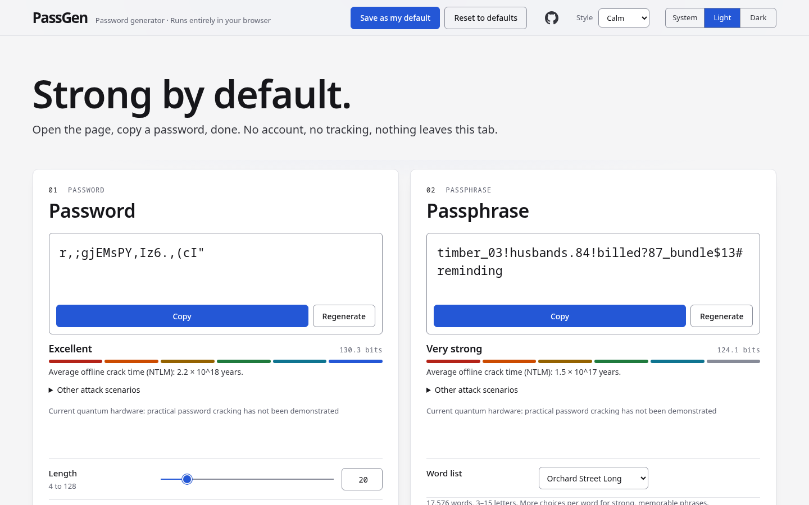
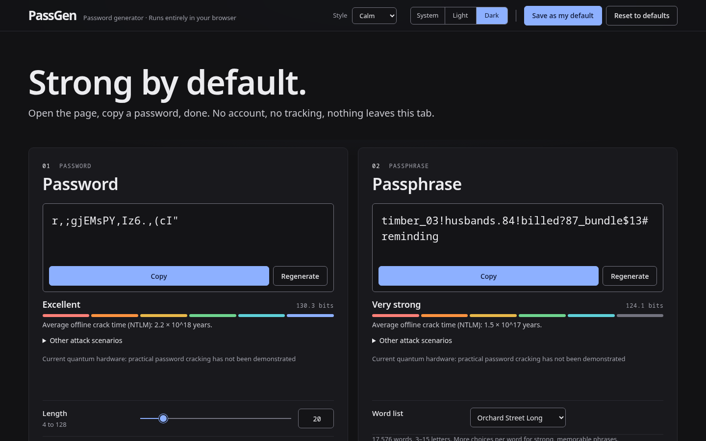
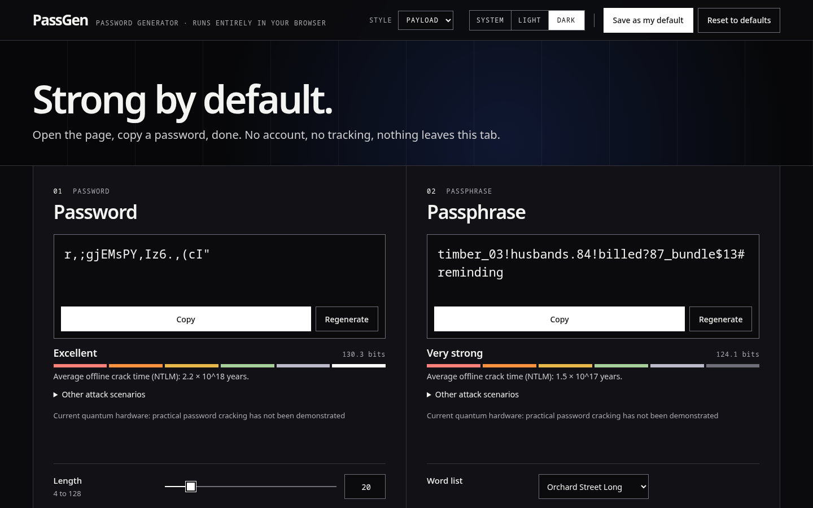
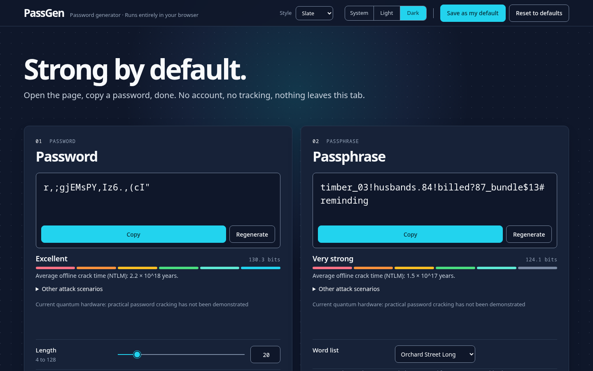
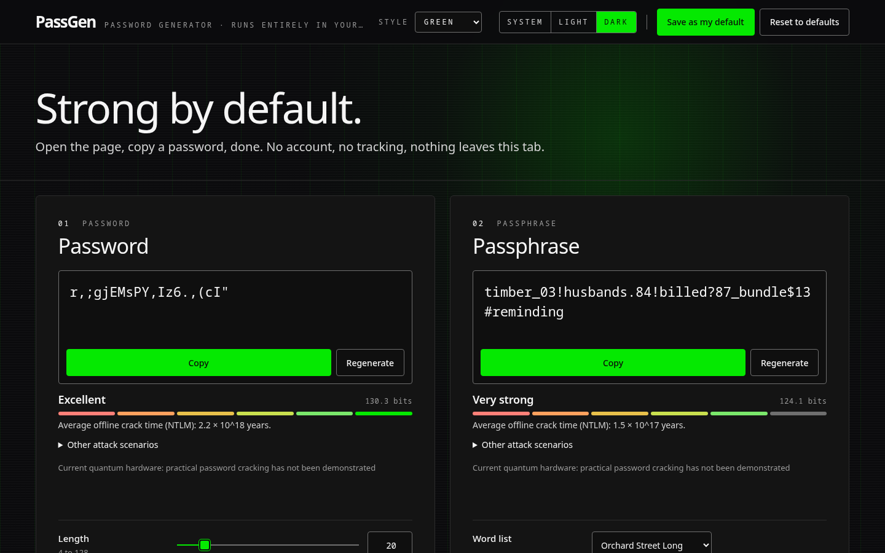
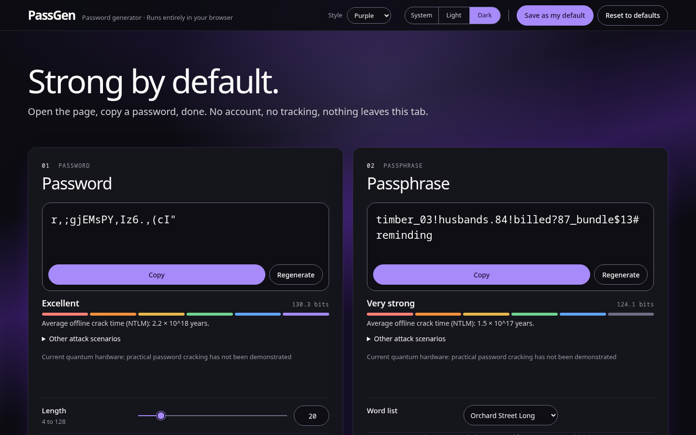
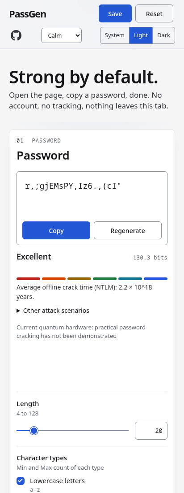

# PassGen

A no-nonsense password and passphrase generator. Open the page, a strong password
is already there, copy it, done. Everything happens in your browser: no accounts,
no tracking, no third-party code, and no network requests after the page loads.
PassGen is a folder of static files. It works on any ordinary static web server, at
any domain or subpath, with no hosting provider, CDN or domain required.

**Status:** v1 is released, with both generators, strength estimates, extra
results, saved settings, and five visual styles. See `CHANGELOG.md` for what
has changed since.

## Screenshots

Calm, the default style, in light and dark themes:

| Light | Dark |
|---|---|
|  |  |

The other four styles, shown in dark theme:

| Payload | Slate | Green | Purple |
|---|---|---|---|
|  |  |  |  |

These are fixed demonstration values; do not use them as passwords.

## Deploy

Pick how to install. Whichever you choose, give PassGen its own hostname so
other pages cannot read generated passwords.

- [By hand](docs/Install-by-hand.md): download the release, unzip it and point your web server at it.
- [Install script](docs/Install-script.md): one command on a Linux server that verifies, backs up and rolls back on failure.
- [Docker](docs/Install-Docker.md): the official image behind Caddy, which gets the HTTPS certificate.
- [AI agent](docs/Install-AI-agent.md): your agent asks about your server and shows every change for approval.
- [Apache](docs/Install-Apache.md), [nginx](docs/Install-nginx.md) or [Caddy](docs/Install-Caddy.md): set up the web server and its security headers.
- [Static hosts and CDNs](docs/Static-hosts-and-CDNs.md): Cloudflare Pages, Netlify, any other static host, and CDN settings.

## Install with an AI agent

> Fetch and follow the instructions at https://raw.githubusercontent.com/mcflycodes/passgen/main/agent-setup/prompt.md to set up PassGen for me.

## Documentation

The [documentation home](docs/README.md) lists every page. The main ones:

- [Configuration](docs/Configuration.md): defaults, limits, page text, links and saved settings.
- [Styles](docs/Styles.md): the five shipped styles and how to add one.
- [Word lists](docs/Word-lists.md): the five passphrase word lists, their sources and licenses.
- [Security headers](docs/Security-headers.md): the headers, the in-page CSP and the build checks.
- [Security](SECURITY.md): supported versions, private vulnerability reporting and the security model.
- [Contributing](CONTRIBUTING.md): setup, commands, checks and contribution guidelines.

## License

Apache-2.0. See `LICENSE` and `NOTICE`.
